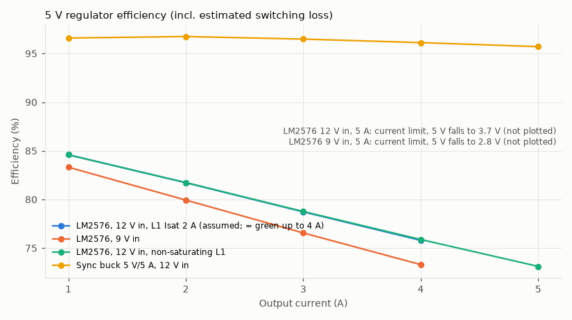
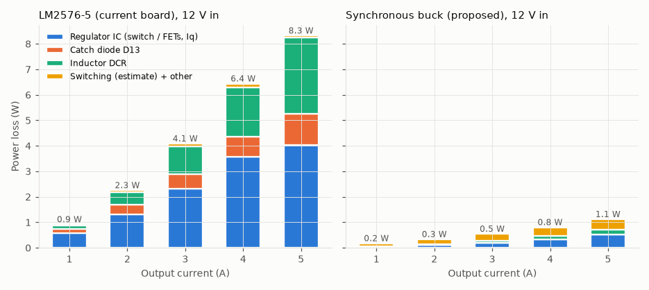
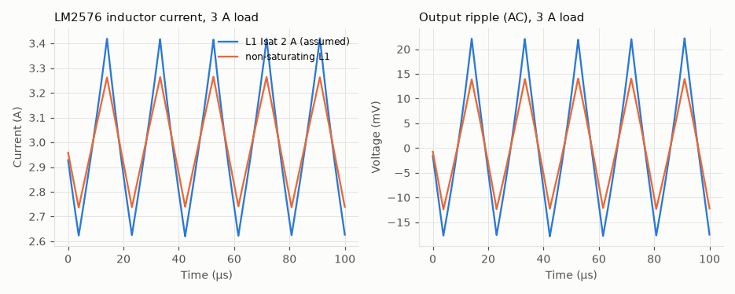
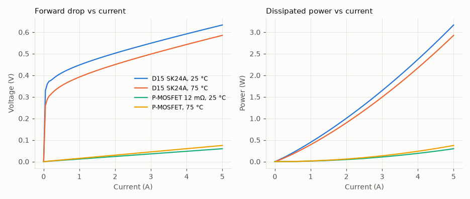
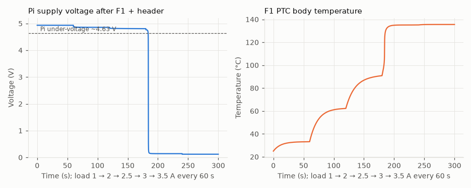
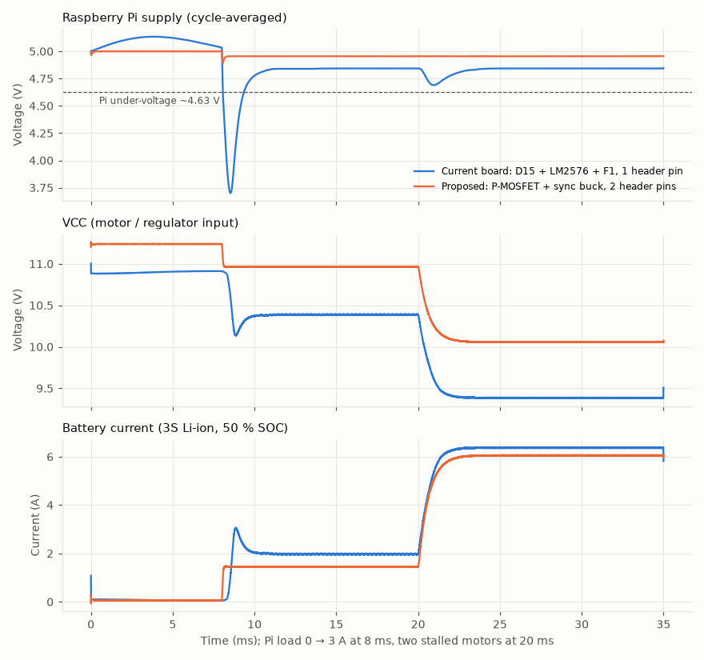
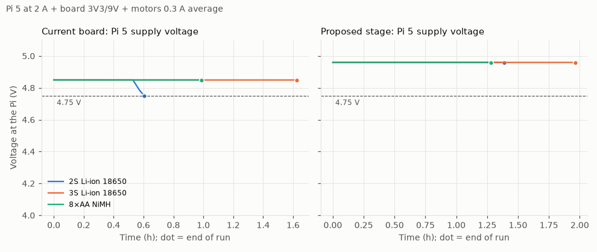
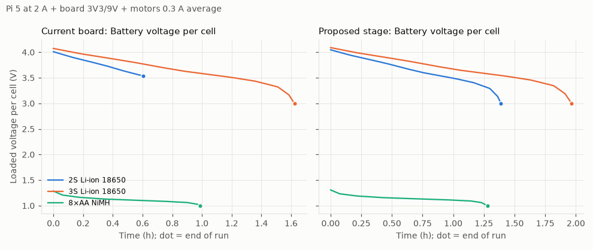

# Power-stage simulation results

ngspice-45.2 simulations of the board power supply (REV2, `hardware/brickpi3/power.kicad_sch`)
and of the proposed Raspberry Pi 5 stage. Netlists, models and the runner are in
[`power/`](power/); tools, model licences and **all assumed values** are listed in
[docs/SIMULATION.md](../docs/SIMULATION.md). Raw numbers: `power/results/*.csv`.

> **How far to trust this.** All parts are behavioural or curve-fitted models built from
> typical datasheet figures, not vendor-validated models. Several key values are
> assumptions (L1 saturation current and DCR, F1 thermal data, LM2576 internal loop,
> wiring resistances, battery parameters). Use the results for **trends and orders of
> magnitude** and to decide what to measure; differences of a few percent or tens of
> millivolts are not meaningful. Where a result depends strongly on an assumption it is
> said below.

## Summary

| Question | Result | Confidence |
| --- | --- | --- |
| LM2576 efficiency, 1–4 A, 12 V in | 85 % → 76 %; loss 0.9 → 6.4 W | good (loss terms from datasheet Vsat / Vf, DCR assumed) |
| Can the LM2576 stage deliver 5 A? | **No.** With the assumed L1 (Isat 2 A) the 5.8 A switch limit is reached and 5 V collapses to 3.7 V (12 V in) / 2.8 V (9 V in) | medium (depends on L1 saturation) |
| D15 SK24A loss | 1.0 W @ 2 A, 1.65 W @ 3 A, 3.2 W @ 5 A (above its 2 A rating) | good |
| F1 PTC | 2 A holds; 3 A trips in ~20 s (25 °C), 2.5 A trips in ~17 s at 50 °C board temperature; 80–170 mV unregulated drop before trip | medium (generic 2 A / 1812 PTC data) |
| Pi 0 → 3 A step, current board | 5 V at the Pi dips to **3.7 V** (4.3 V with a 3× faster loop), below the ~4.63 V under-voltage level for 0.5–1.3 ms; settles at 4.84 V | low for the dip size (unknown LM2576 compensation), good for the settled value |
| Same step, proposed stage | dip to 4.89 V (3 A) / 4.82 V (5 A), settles at 4.95 / 4.92 V | medium |
| Sync buck 5 V / 5 A efficiency | 96–97 % in the model; expect **92–95 %** for a real part | model is optimistic (no core / Coss losses) |
| Run time, 3S 18650 2.6 Ah, Pi 5 (~10 W) + motors | 1.6 h now → 2.0 h with the proposed stage | medium |
| 2S Li-ion | unusable with the current stage (5 V lost after 0.6 h with 47 % charge left); works with the proposed stage (1.4 h) | medium |
| 8×AA NiMH | 1.0 h now → 1.3 h proposed (Pi 5) | medium (holder resistance assumed) |

## 1. LM2576-5 stage at constant load

Switching model at 52 kHz, 12 V and 9 V input (after D15), L1 100 µH with DCR 0.12 Ω,
CP7 1000 µF / 50 mΩ. Efficiency includes an analytic estimate of switching-transition loss
(100 ns, ≤ 0.16 W). Files: `01_lm2576_sweep.csv`, `01_lm2576_sweep_isat10A.csv`.

| Vin | Iout | Efficiency | Total loss | IC (switch, Iq) | D13 | L1 DCR | Ripple (mV p-p) | IL peak |
| --- | --- | --- | --- | --- | --- | --- | --- | --- |
| 12 V | 1 A | 84.6 % | 0.92 W | 0.57 W | 0.18 W | 0.12 W | 28 | 1.28 A |
| 12 V | 2 A | 81.7 % | 2.26 W | 1.31 W | 0.38 W | 0.48 W | 30 | 2.31 A |
| 12 V | 3 A | 78.7 % | 4.09 W | 2.31 W | 0.58 W | 1.09 W | 40 | 3.42 A |
| 12 V | 4 A | 75.8 % | 6.44 W | 3.58 W | 0.78 W | 1.93 W | 59 | 4.63 A |
| 12 V | 5 A | – (current limit, 3.7 V out) | | | | | 223 | 5.80 A |
| 9 V | 1 A | 83.3 % | 1.01 W | 0.74 W | 0.12 W | 0.12 W | 18 | 1.18 A |
| 9 V | 3 A | 76.6 % | 4.63 W | 3.13 W | 0.33 W | 1.08 W | 23 | 3.23 A |
| 9 V | 4 A | 73.3 % | 7.35 W | 4.91 W | 0.41 W | 1.92 W | 31 | 4.31 A |
| 9 V | 5 A | – (current limit, 2.8 V out) | | | | | 242 | 5.80 A |

Conclusions:

- The model reproduces the datasheet figure (~77 % at 12 V / 3 A) within ~2 %, which
  supports the loss terms; the existing estimate of 3–4.5 W heat at 2–3 A in `docs/POWER.md`
  is confirmed (2.3–4.1 W in the regulator + inductor, plus D15).
- The **Darlington switch** (1.0–1.4 V saturation) is the largest loss; the second is
  **L1 DCR** (I²·R, 1.9 W at 4 A if DCR is really 0.12 Ω). Both grow quickly with current.
- With an inductor that saturates around 2 A the ripple and peak current grow (40 vs
  26 mV at 3 A) and at 5 A the peak reaches the 5.8 A switch limit, so **the LM2576 stage
  cannot supply a Pi 5 at 5 A** even before thermal limits. With a non-saturating inductor
  5 A is regulated, but at 73 % efficiency and 9.3 W loss – not practical on this board.

## 2. D15 and the PTC fuse F1

`02_d15_vs_pfet.csv`, `02_ptc_trip.csv`.

| Current | D15 Vf / loss @ 25 °C | D15 @ 75 °C | P-MOSFET (12 mΩ) Vds / loss @ 25 °C | @ 75 °C |
| --- | --- | --- | --- | --- |
| 1 A | 0.45 V / 0.45 W | 0.39 V / 0.39 W | 12 mV / 0.012 W | 15 mV / 0.015 W |
| 2 A | 0.50 V / 1.00 W | 0.45 V / 0.90 W | 24 mV / 0.048 W | 30 mV / 0.060 W |
| 3 A | 0.55 V / 1.65 W | 0.50 V / 1.49 W | 36 mV / 0.11 W | 45 mV / 0.14 W |
| 5 A | 0.63 V / 3.17 W | 0.59 V / 2.93 W | 60 mV / 0.30 W | 75 mV / 0.37 W |

F1 (behavioural model of a 2 A-hold 1812 polymer PTC), constant load from cold:

| Board temp. | 2.0 A | 2.5 A | 3.0 A | 3.5 A | 4 A | 5 A |
| --- | --- | --- | --- | --- | --- | --- |
| 25 °C | holds (63 °C) | holds (93 °C) | trips in 20 s | 11.5 s | 7.9 s | 4.5 s |
| 50 °C | holds (94 °C) | trips in 17 s | 9.6 s | 6.3 s | 4.6 s | 2.8 s |

Before tripping F1 drops 77 mV @ 2 A, 100 mV @ 2.5 A, 130 mV @ 3 A; with ~30 mΩ of
header pin and traces the Pi sees 4.86 / 4.82 / 4.78 V. Because F1 is **after the
LM2576 feedback point** this drop is never corrected.

Conclusions:

- D15 is a 2 A part carrying the whole board current; at 3 A (Pi 4 + motors, or Pi 5
  idle + motors) it dissipates ~1.5–1.7 W in an SMA package, which matches the hot spot
  seen with the thermal camera. A P-MOSFET cuts this loss by ~15× (0.1 W at 3 A).
- F1 is a reasonable protection for a Pi 3/4 (≤ 2 A) but **incompatible with a Pi 5**:
  normal Pi 5 peaks of 3 A trip it within seconds, earlier on a warm board.
  After tripping the Pi loses power until the load is removed and F1 cools.

## 3. Load steps (current board vs proposed)

3S Li-ion pack at 50 % SOC (also 10 %), Pi load 0 → 3 A at 8 ms (50 µs rise, 47 µF at the
Pi), two stalled motors (~2.1 A each from VCC) at 20 ms. `03_04_load_steps.csv`,
`*_waveforms.csv` (10 µs, cycle-averaged).

| Case | Vpi before | Vpi min at Pi step | Vpi settled | Vpi min at motor step | Time < 4.63 V | VCC min | IL peak | Battery peak |
| --- | --- | --- | --- | --- | --- | --- | --- | --- |
| Current board, SOC 50 % | 5.05 V | **3.70 V** | 4.84 V | 4.69 V | 1.3 ms | 9.3 V | 5.6 A | 6.9 A |
| Current board, SOC 10 % | 5.05 V | 3.81 V | 4.84 V | 4.67 V | 1.3 ms | 8.4 V | 5.2 A | 6.6 A |
| Current board, 3× faster loop | 5.01 V | 4.27 V | 4.84 V | 4.78 V | 0.5 ms | 9.3 V | 5.6 A | 6.9 A |
| Current board, non-saturating L1 | 5.05 V | 3.69 V | 4.84 V | 4.67 V | 1.2 ms | 9.3 V | 5.2 A | 6.9 A |
| Proposed, 3 A step | 5.00 V | 4.89 V | 4.95 V | 4.95 V | 0 | 10.0 V | 4.1 A | 6.3 A |
| Proposed, 5 A step | 5.00 V | 4.82 V | 4.92 V | 4.92 V | 0 | 9.8 V | 6.2 A | 7.4 A |
| Proposed, 5 A step, SOC 10 % | 5.00 V | 4.82 V | 4.92 V | 4.92 V | 0 | 8.9 V | 6.2 A | 7.3 A |

Conclusions:

- The **settled** Pi voltage of the current board at 3 A is 4.84 V (F1 + one header pin);
  the proposed stage gives 4.95 V at 3 A and 4.92 V at 5 A.
- The **dip** on the current board is large in every variant (3.7–4.3 V). Its exact size
  depends on the LM2576 internal compensation, which is not public; the sensitivity run
  with a 3× faster loop still falls below 4.63 V. The physical reason is the slow
  52 kHz voltage-mode loop plus the large L1/CP7 filter; a 500 kHz current-mode buck
  recovers in tens of microseconds.
- The stalled motors pull VCC down by ~1 V (pack and wiring resistance, D15). Neither
  stage loses regulation, but with D15 the regulator input is ~0.6–0.7 V lower.
- 2 × 2.1 A of stalled motor current is above the TB6612's 1.2 A continuous rating per
  channel; the simulation does not model the driver's thermal shutdown.

## 4. Proposed synchronous buck at constant load

Generic 500 kHz peak-current-mode buck, 25/12 mΩ FETs, 3.3 µH / 8 mΩ, 2×22 µF + 220 µF
polymer; 20 ns transitions and 50 mW drive added analytically. `04_syncbuck_sweep.csv`.

| Vin | 1 A | 2 A | 3 A | 4 A | 5 A |
| --- | --- | --- | --- | --- | --- |
| 12 V efficiency / loss | 96.6 % / 0.18 W | 96.8 % / 0.34 W | 96.5 % / 0.55 W | 96.1 % / 0.81 W | 95.7 % / 1.12 W |
| 9 V efficiency / loss | 97.0 % / 0.16 W | 97.1 % / 0.30 W | 96.8 % / 0.50 W | 96.3 % / 0.76 W | 95.9 % / 1.07 W |

Ripple 7–9 mV p-p. These efficiencies are **optimistic** by ~2–4 % (no core loss, no
Coss / reverse-recovery loss, ideal gate timing); real 5 V / 5–6 A modules and TPS56637-class
parts reach about 92–95 % at 12 V → 5 V. Even then the loss at 5 A is ~1.5–2 W instead of
the LM2576's 6–9 W at 4–5 A.

## 5. Batteries and run time

Averaged regulator models (same loss terms as above), Pi at constant current
(Pi 5: 2.0 A ≈ 10 W, Pi 4: 1.2 A ≈ 6 W), board 3V3/9V loads, motors 0.3 A average from VCC.
Cells: 18650 2.6 Ah, NiMH AA 2.0 Ah. The run ends when a loaded cell reaches 3.0 V
(Li-ion, typical BMS cut-off) / 1.0 V (NiMH) or the Pi voltage falls below 4.75 V.
`05_battery_runtime.csv`.

| Source | Stage | Load | Battery power | 5 V path efficiency | Run time | Ends by | Charge left |
| --- | --- | --- | --- | --- | --- | --- | --- |
| 2S Li-ion | current | Pi 5 | 17.1 W | 65 % | **0.61 h** | Pi voltage < 4.75 V | **47 %** |
| 2S Li-ion | proposed | Pi 5 | 13.4 W | 90 % | 1.39 h | cell cut-off | 3 % |
| 3S Li-ion | current | Pi 5 | 17.3 W | 70 % | 1.62 h | cell cut-off | 2 % |
| 3S Li-ion | proposed | Pi 5 | 14.6 W | 90 % | **1.97 h** | cell cut-off | 2 % |
| 8×AA NiMH | current | Pi 5 | 17.0 W | 68 % | 0.99 h | cell cut-off | 6 % |
| 8×AA NiMH | proposed | Pi 5 | 13.9 W | 90 % | 1.28 h | cell cut-off | 4 % |
| 2S Li-ion | current | Pi 4 | 11.1 W | 66 % | 1.51 h | Pi voltage < 4.75 V | 13 % |
| 3S Li-ion | current | Pi 4 | 11.9 W | 70 % | 2.43 h | cell cut-off | 2 % |
| 3S Li-ion | proposed | Pi 4 | 10.5 W | 87 % | 2.80 h | cell cut-off | 1 % |
| 8×AA NiMH | current | Pi 4 | 11.4 W | 69 % | 1.59 h | cell cut-off | 3 % |

"5 V path efficiency" = Pi power ÷ (battery power − motor power); the 3V3/9V board
loads (~0.5 W) count as overhead. With a 3.2 V/cell low-voltage cut-off (recommended for
cell life) 3S run times are ~4 % shorter (1.57 h / 1.91 h for Pi 5).

Conclusions:

- **3S Li-ion is the right choice** for both stages; the 1.4–2 h estimate in
  `docs/POWER.md` is confirmed (1.6 h now, 2.0 h with the proposed stage, Pi 5 at ~10 W).
- **2S Li-ion does not work with D15 + LM2576**: after ~0.6 h the loaded pack is at
  ≈ 7.1 V, VCC after D15 ≈ 6.5 V, and the LM2576 dropout leaves < 4.9 V at its output;
  the Pi browns out with half of the charge left. With a P-MOSFET and a synchronous buck (≈ 5.6 V minimum input at
  90 % max duty) 2S is usable down to the cell cut-off.
- 8×AA NiMH reaches only ~1–1.3 h with a Pi 5. The result is sensitive to the assumed
  cell + holder resistance (45 mΩ per cell) and to the real capacity at 1.5–2 A.

## Recommendations for the next board revision

Ordered by benefit for Pi 5 support; each item names what the simulation showed.

1. **Replace the LM2576 with a synchronous buck 5 V / 5–6 A** (e.g. TPS56637-class, or a
   Pololu D36V50F5-type module for the prototype). Loss at 3 A drops from ~4 W to
   ~0.6–1 W, 5 A becomes possible, and the load-step dip shrinks from ~1 V to ~0.1 V.
2. **Replace D15 with a P-MOSFET** (≥ 30 V, ≤ 15 mΩ, gate zener 10–12 V) **or an ideal-diode
   controller with an N-MOSFET** (lower loss, true reverse-current blocking). Saves
   1–3 W at 2–5 A and gives ~0.5 V more headroom, which is what makes 2S packs usable.
3. **Remove F1 from the 5 V output path.** Protect at the input instead (eFuse / hot-swap
   controller or a correctly sized fuse on VCC) and rely on the buck's current limit for
   the 5 V rail. If a PTC stays, it must be rated ≥ 6 A hold at the expected board
   temperature and sit *inside* the regulation loop.
4. **Sense the output after any series element** (remote sense at the header) and **feed
   both 5 V header pins (2 and 4)** with wide copper. Together with removing F1 this
   raises the Pi voltage at 3 A from 4.84 to 4.95 V in the model.
5. **Inductor:** if the LM2576 stays for Pi 3/4 builds, use an inductor with Isat ≥ 4 A
   and DCR ≤ 50 mΩ; at 3 A the DCR alone costs ~1 W with the assumed SDR1806 value.
6. **Battery:** standardise on 3S Li-ion with BMS and a 9.6 V (3.2 V/cell) low-voltage
   warning/cut-off measured by the MCU; keep 8×AA as a low-power option only.
7. **Motors:** stalled LEGO motors draw ~2 A per channel, above the TB6612's 1.2 A
   continuous rating; add firmware stall detection / current limiting (PWM duty limit)
   and keep VCC bulk capacitance with low ESR close to the drivers.

## What to measure on the real board

The model is only as good as these inputs; measuring them would remove most of the
uncertainty above:

- L1 inductance vs DC current (saturation) and DCR; actual part number of L1.
- 5 V at the Pi header and at CP7 during a Pi boot (oscilloscope, 10 µs/div) – gives
  the real LM2576 dip and loop speed.
- D15, LM2576 and L1 temperatures at 1, 2 and 3 A with a thermal camera.
- F1 resistance at 25 °C and the trip time at 3 A.
- Battery pack internal resistance (voltage step at a 2 A load change).
